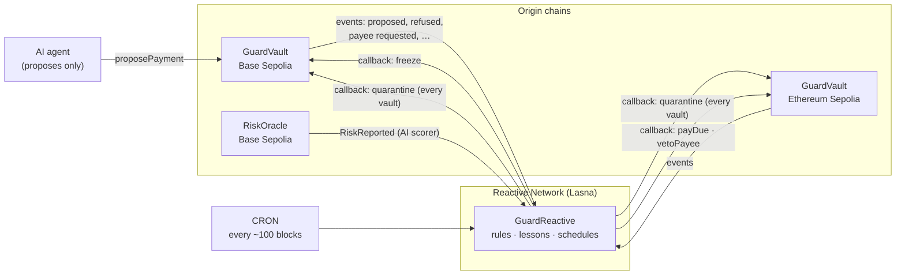

<div align="center">


# Antibody Guard

### An immune system for agent wallets.

**A guarded vault holds an AI agent's funds. A Reactive contract watches every vault from Reactive Network and acts on its own: it freezes a vault under attack, and an attacker caught on one vault is quarantined on every other vault, on every chain.**

[](https://github.com/linoxbt/Antibody-gaurd/actions/workflows/ci.yml)
[](https://lasna.reactscan.net/address/0x4d15b3af1a723d158f63f61002577e9a8b998440)
[](https://repo.sourcify.dev/5318007/0x4d15b3af1a723d158f63f61002577e9a8b998440)
[](test)
[](LICENSE)

[**Live app**](https://antibody-guard-reactive.netlify.app) ·
[**Console**](https://antibody-guard-reactive.netlify.app/app) ·
[**Walkthrough**](https://antibody-guard-reactive.netlify.app/walkthrough) ·
[**Evidence**](https://antibody-guard-reactive.netlify.app/evidence) ·
[**Security**](https://antibody-guard-reactive.netlify.app/security) ·
[**Build plan**](docs/PLAN.md)

</div>

---

## Contents

- [Why Antibody Guard](#why-antibody-guard)
- [How it works](#how-it-works)
- [See it live](#see-it-live)
- [Quick start](#quick-start)
- [The rules](#the-rules)
- [Contracts](#contracts)
- [The AI risk scorer](#the-ai-risk-scorer)
- [Guard service API](#guard-service-api)
- [Architecture](#architecture)
- [Development](#development)
- [Configuration](#configuration)
- [Deployment and operations](#deployment-and-operations)
- [Security model](#security-model)
- [Limitations and roadmap](#limitations-and-roadmap)
- [Documentation](#documentation)
- [Disclosures and license](#disclosures-and-license)

---

## Why Antibody Guard

AI agents now hold money and pay bills. An agent that reads an inbox can be
talked into paying an attacker: a look-alike invoice, a "new bank details"
email, a prompt injection hidden in a document. Once the agent holds a key
that can move funds, one bad decision is final.

Antibody Guard takes that power away from the agent, and gives its vaults a
shared memory that spans every chain they live on:

| | An agent with a hot wallet | An agent behind Antibody Guard |
|---|---|---|
| **Who moves funds** | The agent, with its own key | The vault. The agent may only *propose* a payment |
| **Who decides** | The model | Fixed on-chain rules: known payee, label, cap, daily limit, duplicates |
| **A burst of bad proposals** | Drains the wallet | The vault is frozen within seconds, with no server involved |
| **An attacker caught once** | Can try again elsewhere | Quarantined on every watched vault, on every chain |
| **A new vault** | Starts naive | Is immunized with every lesson learned so far |
| **Audit** | Logs on a server | Every decision is an on-chain event, linked to its origin and its callback |

---

## How it works



1. **Propose.** The agent never holds a key that can move funds. It calls
   `proposePayment(to, token, amount, label)` on its `GuardVault`.
2. **Check.** The vault pays only a registered payee, under the payee's cap
   and the daily limit, and refuses duplicates. A refusal is an event, not a
   revert, so everything watching the vault sees it.
3. **React.** `GuardReactive` on Reactive Network subscribes to the events of
   every watched vault (up to 12, on any supported chain), the RiskOracle and
   Reactive's CRON. Its rules run on Reactive Network, with no server in the
   loop.
4. **Act.** It sends callbacks through each chain's callback proxy: freeze a
   vault, quarantine an address on every vault, veto a payee change, pay a
   recurring payment. The vault accepts a callback only from the proxy and
   only when it names the vault's guardian. Every callback is idempotent,
   because Reactive may deliver a log twice.
5. **Remember.** Every quarantined address becomes a *lesson*. A vault that
   is watched later is immunized with every lesson the moment it joins.

---

## See it live

Everything below ran on public testnets on **19 November 2026**, from a
fresh install of the `guard` CLI, against the production service. Every
step is a transaction you can open.

| Step | What happened | Proof |
|---|---|---|
| Deploy | A new GuardVault on Base Sepolia, with an owner and an agent from fresh keys | [vault](https://sepolia.basescan.org/address/0xB81e6E017035fDCF61fc0Ea8C7C83ee217355767) |
| Watch | GuardReactive starts watching it and immunizes it with every known attacker | [Lasna tx](https://lasna.reactscan.net/tx/0x063bfe04e5d245a03e311d52c53c5f3780e543a87e9e276f3a9090546e0a0a49) |
| Pay | 0.0005 ETH to the registered payee `alice` | [paid](https://sepolia.basescan.org/tx/0xeafcfccd8794d75664b38a633fd031ffb8f0d68e0fa69079beee3ed234d52ee8) |
| Over cap | 0.002 ETH to `alice` (cap 0.001) | [refused: `OverCap`](https://sepolia.basescan.org/tx/0x655b0c31df4356457bcdca0d67a2f69817c977cd84a9324e3c88eda176511b8a) |
| **Attack** | The agent tries to pay an unknown address under the label `alice` | [refused: `UnknownPayee`](https://sepolia.basescan.org/tx/0x5e129201a16644ec0ce9b58f7ba5792ac95fc02bb8db98efdd38874e603dfd40) |
| **Immune response** | Within about 30 s, the attacker is quarantined on **all 5 watched vaults**, on Base Sepolia and Ethereum Sepolia | [Attackers](https://antibody-guard-reactive.netlify.app/app/attackers) |
| Repeated refusals | Reactive freezes the vault (`RepeatedRefusals`); later proposals are refused with `Frozen` | [Loops](https://antibody-guard-reactive.netlify.app/app/loops) |
| Recovery | The owner unfreezes the vault; the next payment is paid | [unfreeze](https://sepolia.basescan.org/tx/0x6c39eea1a38d2ebac309e1d3940d95b5522ed029aebc832feb651f8aa31b5365) |

Across the run, origin-to-callback latency was **1 to 6 seconds** (median
2 s; Ethereum Sepolia's 12-second blocks set the upper end). A final
on-chain check found each of the 6 known attackers quarantined on each of
the 6 watched vaults: 36 of 36. The record of every phase, with every
transaction, is on the [Evidence page](https://antibody-guard-reactive.netlify.app/evidence)
and in [`docs/`](docs).

---

## Quick start

There are three ways in.

<details open>
<summary><b>Browser: your own vault in five steps</b></summary>

Open [**My vault**](https://antibody-guard-reactive.netlify.app/app/my-vault)
and connect a wallet (Reown AppKit: browser wallets and WalletConnect). With
a little Base Sepolia or Ethereum Sepolia ETH:

1. **Deploy GuardVault.** You are the owner; the agent defaults to your wallet.
2. **Set guardian.** GuardReactive becomes the vault's guardian.
3. **Ask Reactive to watch.** The service checks that the vault is a genuine
   GuardVault and registers it; the vault is immunized with every lesson at
   once.
4. **Request a payee**, wait for the payee delay, then **Activate** it.
5. **Propose** payments, and watch the vault's rules and Reactive respond.

[**Public actions**](https://antibody-guard-reactive.netlify.app/app/actions)
holds what anyone may do: top up GuardReactive's lREACT reserves, retry a
failed freeze or quarantine, and activate a payee whose delay has passed.

</details>

<details>
<summary><b>CLI: the <code>guard</code> command</b></summary>

Needs git and Node.js 22.

```sh
curl -fsSL https://antibody-guard-reactive.netlify.app/install.sh | bash

guard keys new owner && guard keys new agent        # testnet keys in ~/.antibody-guard
guard vault deploy --agent <agent address> --delay 60 --fund 0.005
guard guardian                                      # GuardReactive becomes the guardian
guard watch                                         # GuardReactive watches it (and immunizes it)
guard payee add alice 0x… --cap 0.001               # timelocked; after the delay:
guard payee activate alice
guard limit 0.003                                   # daily limit
guard propose 0x… 0.0005 alice                      # as the agent: paid, or refused with a code
guard status                                        # the vault, its guardian, the known attackers
guard loops                                         # origin → reaction → callback, with times
```

Also: `guard check` (a dry run), `guard schedule add|cancel` (recurring
payments on Reactive's CRON), `guard freeze|unfreeze|release|withdraw`,
`guard score` (the AI scorer) and `guard health` (Reactive MCP). Every
command takes `--chain baseSepolia|sepolia`, `--vault <address>` and
`--json`.

</details>

<details>
<summary><b>From source</b></summary>

```sh
git clone https://github.com/linoxbt/Antibody-gaurd && cd Antibody-gaurd
npm ci
npm run deps        # fetches reactive-lib-omni at a pinned commit into lib/ (not committed)
npm run build       # Hardhat 3, solc 0.8.30
npm test            # 65 Solidity tests
npm run typecheck
```

</details>

---

## The rules

**In the vault** (`GuardVault`, on each origin chain). A proposal is paid
only if every check passes. Otherwise it is refused with a code:

| Code | Refused when |
|---|---|
| `Frozen` | The vault is frozen, by its owner or by GuardReactive |
| `Quarantined` | The recipient is a quarantined address |
| `UnknownPayee` | The recipient is not a registered payee |
| `LabelMismatch` | The label does not belong to that recipient |
| `OverCap` | The amount is above the payee's cap |
| `OverDailyLimit` | The day's spending would exceed the daily limit |
| `Duplicate` | The same payee and amount were paid in the last 10 minutes |
| `TransferFailed` | The transfer itself failed (and is rolled back) |

Payee changes are timelocked. The delay can only grow, up to 30 days, and
anyone may activate a change once its delay has passed. A quarantined address
can never be activated as a payee.

**In Reactive Network** (`GuardReactive`, on Lasna). Each decision is a
`Decision` event naming the rule, the vault, the subject and the origin
transaction:

| Rule | Trigger | Response |
|---|---|---|
| `Burst` | More than 5 proposals within 120 s on one vault | Freeze that vault |
| `RepeatedRefusals` | 3 refusals within 600 s on one vault | Freeze that vault |
| `UnknownRecipient` | The agent tried to pay an address that is not a payee | Quarantine it on **every** watched vault |
| `CrossChainQuarantine` | An address was quarantined on any watched vault | Quarantine it on every other vault (a *lesson*) |
| `AiRisk` | The RiskOracle reports an address at a score of 80 or more | Quarantine it on every watched vault |
| `PayeeVeto` | A payee change points at a known attacker | Veto the change before it can be activated |
| `ScheduledPayment` | A recurring payment falls due on Reactive's CRON | `payDue`, under the same vault rules |
| `Retry` | A freeze or quarantine has not landed after 10 minutes | Anyone may call `retryFreeze` or `retryQuarantine` |

The thresholds are owner settings (`setSettings`). CRON is subscribed only
while a schedule is active, because every tick is billed.

---

## Contracts

Every contract, current and retired, is verified on Sourcify (exact match).
The current deployment:

| Contract | Chain | Address | |
|---|---|---|---|
| `GuardReactive` v5 | Reactive Lasna | [`0x4d15…8440`](https://lasna.reactscan.net/address/0x4d15b3af1a723d158f63f61002577e9a8b998440) | [Sourcify](https://repo.sourcify.dev/5318007/0x4d15b3af1a723d158f63f61002577e9a8b998440) |
| `GuardVault` v2 | Base Sepolia | [`0x114e…c7d2`](https://sepolia.basescan.org/address/0x114e6c7e2cd7feeec8d75912cf762f1fc45dc7d2) | [Sourcify](https://repo.sourcify.dev/84532/0x114e6c7e2cd7feeec8d75912cf762f1fc45dc7d2) |
| `GuardVault` v2 | Ethereum Sepolia | [`0xb30c…5d4b`](https://sepolia.etherscan.io/address/0xb30ccddd31c4e14186801d74ea45a905b7305d4b) | [Sourcify](https://repo.sourcify.dev/11155111/0xb30ccddd31c4e14186801d74ea45a905b7305d4b) |
| `RiskOracle` | Base Sepolia | [`0xe067…322e`](https://sepolia.basescan.org/address/0xe067e2b0a06d6019442ec8371ee2ad407b2d322e) | [Sourcify](https://repo.sourcify.dev/84532/0xe067e2b0a06d6019442ec8371ee2ad407b2d322e) |

Visitors' vaults, deployed from the console or the CLI, are watched by the
same GuardReactive. The live list is on the
[Vaults](https://antibody-guard-reactive.netlify.app/app/vaults) page.

<details>
<summary><b>Earlier versions</b> (still deployed, as the record of each phase)</summary>

| Contract | Chain | Address | What it added |
|---|---|---|---|
| `GuardReactive` v4 | Lasna | [`0xc0f9…8814`](https://lasna.reactscan.net/address/0xc0f92c45a5147b408c0bcbeab7dacfb27eb78814) | AI risk: trusts the RiskOracle. Retired by v5, which imported its lessons |
| `GuardReactive` v3 | Lasna | [`0x5208…37c0`](https://lasna.reactscan.net/address/0x5208c022571739fbef6198959bd7af89effd37c0) | Callback gas limits per destination chain |
| `GuardReactive` v2 | Lasna | [`0x7900…a282`](https://lasna.reactscan.net/address/0x7900d7765473eba75a816ccf58a481399036a282) | Lessons, immunization, payee veto, CRON payments |
| `GuardReactive` v1 | Lasna | [`0xb30c…5d4b`](https://lasna.reactscan.net/address/0xb30ccddd31c4e14186801d74ea45a905b7305d4b) | Burst and refusal freezes, unknown-recipient quarantine |
| `GuardVault` v1 | Base Sepolia | [`0xb30c…5d4b`](https://sepolia.basescan.org/address/0xb30ccddd31c4e14186801d74ea45a905b7305d4b) | The guarded vault |

Several contracts share the address `0xb30c…5d4b`: the same deployer created
each as its first contract, on different chains. Every version's addresses
and transactions are in [`deployments/`](deployments).

</details>

---

## The AI risk scorer

The scorer reads an incoming message, such as an email or an invoice. If the
message is trying to redirect money, it reports the address to the
`RiskOracle` with a score, an evidence hash and a reason. A report at 80 or
more becomes an `AiRisk` lesson: the address is quarantined on every watched
vault.

The model is boxed in:
- it can report only an address that appears verbatim in the message;
- it can never report a registered payee;
- a report can only *restrict*: it quarantines, and never pays or unfreezes;
- the oracle changes nothing by itself; GuardReactive decides.

**Steward** (`agent/steward.ts`) is the agent side: an AI that pays bills
from an untrusted inbox through three tools, `lookup_payee`, `check_payment`
(a dry run against the vault's rules) and `propose_payment`. The model runs
on Fortytwo (`qwen/qwen3.8-27b`) or any OpenAI-compatible endpoint. Every
recorded run, with each tool call, is in [`docs/agent-runs/`](docs/agent-runs).
Try the scorer on the [AI scorer](https://antibody-guard-reactive.netlify.app/app/scorer)
page.

---

## Guard service API

The Guard service indexes the vaults, the RiskOracle and GuardReactive on all
three chains, and links each decision to its origin transaction and its
callback. The site proxies `/api/*` to it, so the page's Content Security
Policy stays `'self'`.

| Method | Path | |
|---|---|---|
| `GET` | `/api/health` | Liveness, and the age of the indexed state |
| `GET` | `/api/state` | Vaults, GuardReactive, lessons, live loops with latencies, recent events |
| `POST` | `/api/score` | `{ from?, subject?, body }`: the AI scorer's verdict, and any on-chain report |
| `POST` | `/api/watch` | `{ chain, vault }`: ask GuardReactive to watch a vault |

`/api/watch` accepts a vault only if its runtime code is GuardVault's, its
guardian is GuardReactive v5 and the cap of 12 vaults has not been reached.
It then sends `watch` from the registrar key.

Rate limits:
- `/api/score`: messages up to 2,000 characters; 3 requests per client per
  10 minutes; 30 model calls and 12 on-chain reports per hour overall.
- `/api/watch`: 2 requests per client per hour, and 6 per hour overall.

---

## Architecture

```
     Browser (Reown AppKit)          guard CLI              AI agent (Steward)
              │                          │                          │
              ▼                          ▼                          ▼
   Netlify site ── /api/* ──► Guard service (Railway) ─► Fortytwo (AI scorer)
     frontend/ · wallet/          indexer · watch · score
              │                          │ registrar and scorer keys (testnet)
              ▼                          ▼
   ┌──────── origin chains ────────┐         ┌──── Reactive Network (Lasna) ────┐
   │ GuardVault   Base Sepolia     │ events  │ GuardReactive v5                 │
   │ GuardVault   Ethereum Sepolia │ ──────► │ rules · lessons · schedules      │
   │ RiskOracle   Base Sepolia     │ ◄────── │ callbacks via each chain's proxy │
   └───────────────────────────────┘         └──────────────────────────────────┘
```

```
contracts/     GuardVault, GuardReactive, RiskOracle, IGuardVault
test/          65 Solidity tests: vault rules, a simulated two-chain relay, CRON, the oracle, gas
scripts/       deploy and run each phase; evidence, Sourcify verification, bridge, faucet, Reactive MCP
agent/         Steward (the paying agent) and the AI risk scorer; any OpenAI-compatible model
service/       the Guard service: indexer and HTTP API (Dockerfile, railway.json)
cli/  bin/     the guard command
frontend/      the site and the console (plain JavaScript, no framework)
wallet/        Reown AppKit and wagmi, bundled by esbuild into a separate, code-split package
abi/           the ABIs, and GuardVault's bytecode for deploying from a wallet
deployments/   every deployment: addresses and transaction hashes only, never a key
docs/          the build plan, evidence per network, the Reactive MCP diagnosis, AI agent runs
```

---

## Development

**Prerequisites:** Node.js 22 and git. There is no other toolchain: the
contracts build with Hardhat 3.

```sh
npm ci
npm run deps          # reactive-lib-omni, pinned, into lib/
npm run build         # compile
npm test              # 65 Solidity tests
npm run typecheck     # scripts, agent, service and CLI
```

**Run the stack locally:**

```sh
npm run service                                        # the Guard service on :8787
(cd wallet && npm ci) && npm run web                   # builds the site into web-dist/
```

**Deploy and operate.** Testnet keys are created in `~/.antibody-guard/`.

```sh
npm run deployer -- show                       # deployer address and balances
npm run phase1                                 # each phase of the build (phase1 to phase4), re-runnable
npm run faucet -- baseSepolia 0.05             # test ETH into lREACT on Lasna
GUARD_RECORD=lasna-v5 npm run deposit -- 0.5   # top up GuardReactive's reserves
npm run evidence -- baseSepolia                # re-read every recorded transaction into docs/
npm run verify -- baseSepolia GuardVault <address>   # Sourcify
npm run rmcp -- tools                          # Reactive MCP (also in .mcp.json)
```

---

## Configuration

Every variable is documented in [`.env.example`](.env.example).

| Where | Variable | |
|---|---|---|
| Guard service | `GUARD_SCORER_KEY` | Secret: the testnet key allowed to report on the RiskOracle |
| | `GUARD_REGISTRAR_KEY` | Secret: the testnet key with GuardReactive's registrar role |
| | `LLM_API_KEY` | Secret: the model key; without it, `/api/score` answers 503 |
| | `LLM_BASE_URL`, `LLM_MODEL`, `LLM_REASONING_EFFORT` | Fortytwo, `qwen/qwen3.8-27b`, `low` |
| | `PORT`, `LOOKBACK_SECONDS`, `NODE_ENV` | `8787`, `7200`, `production` |
| Site build | `GUARD_API_ORIGIN` | Where `/api/*` is proxied |
| | `REOWN_PROJECT_ID` | The public Reown project ID, built into the wallet bundle |
| | `NODE_VERSION` | `22` |
| CLI | `GUARD_API`, `GUARD_KEY_DIR`, `GUARD_OWNER_KEY`, `GUARD_AGENT_KEY`, `GUARD_DEBUG` | |

Secrets live only on the service that uses them. The site is static and
public, and holds none.

---

## Deployment and operations

| Service | Host | URL |
|---|---|---|
| Site and console | Netlify, built from `main` | https://antibody-guard-reactive.netlify.app |
| Guard service | Railway (`Dockerfile`) | https://antibody-guard-production.up.railway.app |
| GuardReactive | Reactive Lasna | [`0x4d15…8440`](https://lasna.reactscan.net/address/0x4d15b3af1a723d158f63f61002577e9a8b998440) |

- **CI** compiles the contracts, runs the Solidity tests and the typecheck,
  and builds the site with its wallet bundle, on every push.
- **Reserves.** GuardReactive pays for each reaction in lREACT. Anyone can
  top it up from the console (*Public actions*) or with `npm run deposit`.
  `guard health` reads its reserves and debt through Reactive MCP.
- **Recovery.** If a callback does not land, `retryFreeze` and
  `retryQuarantine` are open to anyone after 10 minutes. The vault's
  callbacks are idempotent, so a retry is always safe.
- **Independence.** The Guard service is needed only to register new vaults,
  score messages and show the dashboard. Protection runs entirely on-chain
  and keeps working when the service is down.

---

## Security model

- **The agent cannot move funds.** It can only propose. The vault decides,
  against rules the agent cannot change.
- **Only the guardian can freeze or quarantine.** The vault accepts a
  callback only from the chain's Reactive callback proxy, and only when it
  names the vault's guardian contract.
- **Restrictive by design.** Reactive and the AI scorer can only freeze,
  quarantine and veto. Unfreezing, releasing and withdrawing belong to the
  owner.
- **Least-privilege keys.** The registrar key can only watch, unwatch and
  immunize; the scorer key can only report. Both are testnet keys held by the
  service, never by the site.
- **Timelocked payees.** A new payee waits out the vault's delay, which can
  only grow. GuardReactive vetoes a change towards a known attacker.
- **Idempotent callbacks.** Reactive may deliver a log twice; every callback
  is safe to repeat.
- **The site** runs under a strict Content Security Policy (`script-src
  'self'`); only Reown and WalletConnect hosts are allowed, for the wallet.
  Wallet actions are simulated before they are sent, so a call the contract
  would refuse shows the contract's error instead of costing gas.
- **No secrets in the repository.** `deployments/` holds addresses and
  transaction hashes only.

Found a vulnerability? Please open a private security advisory on this
repository rather than a public issue.

---

## Limitations and roadmap

- **Testnet only.** Base Sepolia, Ethereum Sepolia and Reactive Lasna. The
  contracts have not had an external audit; do not hold real funds in them.
- **Tokens.** The vault pays the chain's coin and ERC-20 tokens, with a daily
  limit per token. The console and the CLI use the chain's coin for now.
- **Vault cap.** One GuardReactive watches up to 12 vaults. More vaults need
  another GuardReactive.
- **One service instance.** The Guard service keeps its index in memory and
  rebuilds it from the chains on start (two hours back).
- **Lessons are permanent.** A lesson cannot be removed from GuardReactive;
  an owner can `release` an address on their own vault.

---

## Documentation

| | |
|---|---|
| [Build plan](docs/PLAN.md) | Every phase, with what was built and what was proven |
| [Evidence](docs) | Each network's transactions, re-read from the chain (`evidence-*.md`) |
| [Reactive MCP](docs/reactive-mcp.md) | Live diagnosis of the contracts with Reactive MCP |
| [AI agent runs](docs/agent-runs) | Every recorded model run, with its tool calls |
| [Evidence page](https://antibody-guard-reactive.netlify.app/evidence) | The contracts, every loop and the AI runs, with links |

---

## Disclosures and license

**Libraries reused** (all open source): `viem`, `tsx`, `hardhat`,
`forge-std` and `typescript`; for the wallet, `@reown/appkit`,
`@reown/appkit-adapter-wagmi`, `wagmi`, `@wagmi/core`,
`@tanstack/query-core` and `esbuild`. Reactive's `reactive-lib-omni` is
fetched at a pinned commit by `npm run deps` and is not redistributed here.

**Services:** Reactive Network (Lasna); the public Base Sepolia and Ethereum
Sepolia RPCs; Fortytwo for the model; Reown for wallet connection; Sourcify
for verification; Netlify and Railway for hosting.

The frontend is ported from [Antibody](https://github.com/linoxbt/Antibody),
the same team's agent-wallet guard on Sui.

Released under the [MIT License](LICENSE).

<div align="center"><sub>Built for the Reactive Omni Buildathon · <a href="https://antibody-guard-reactive.netlify.app">antibody-guard-reactive.netlify.app</a></sub></div>
